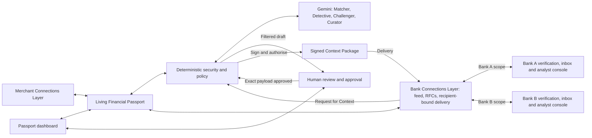

# Alibi

> **Your money’s alibi, ready before anyone asks.**

Alibi is a living, user-controlled financial passport. It connects bank transactions to the receipts, sales, refunds and settlement records that explain them. It keeps that evidence ready in the background. When a bank asks about a payment, Alibi investigates the stated request, challenges weak explanations and prepares the smallest supported response. The account holder decides exactly what to share. The analyst verifies and reviews what arrives.

**The passport is the product.** It builds a reusable evidence history before anyone asks for it. A bank information request is the first demonstration of how that history helps its owner respond without disclosing unrelated financial activity. The agents maintain, investigate and selectively present the passport; they do not replace it.

**AgentVerse 2026 · Finance Track · Hackathon build specification, revised**  
**Team submission deadline:** Sunday 8 November 2026 at **12:30 London time (GMT)**.  
**Status:** Proposed build requirements and acceptance tests, not a claim of implemented features. Setup commands, measured results and completed acceptance checks are pending.

[Task](#task-brief) · [Scope](#product-requirements) · [Contracts](#technical-contracts) · [Evaluation](#evaluation) · [Build plan](#five-person-build-plan) · [Demo](#four-minute-demo) · [Setup](#setup-and-documentation)

## Task brief

The Finance Track asks teams to help a specific person make a better financial decision, with evidence a professional can check and human oversight for consequential actions. Alibi follows **Maya, a student who resells clothes**. Her account is restricted while her bank asks her to explain a credit. Rent is due soon. She needs to decide **which records to share to explain that credit**. The bank analyst makes a separate review decision.

A bank credit shows that money arrived. The marketplace may hold the sale, refund, fee and settlement records that explain its source. Alibi collects and links these records before the request. In the demo, sales less refunds and fees add up to the credit, but a merchant message describes money released to a platform balance rather than proof of transfer to the bank. Alibi must distinguish those events, identify the relevant payout and retrieve the missing settlement evidence. Matching amounts alone must not become a supported source-of-funds claim. A separate signed-status correction tests deterministic invalidation; it is not the demonstration of LLM necessity.

**Build one complete passport workflow:** maintain Maya’s history, surface a proactive alert, accept a bank Request for Context, investigate using both connections, prepare a reviewable draft, and deliver the exact approved package to a bank-side verifier and analyst. Reuse that persisted passport for a different question from a second mock recipient, without re-importing records or reusing consent. Work exclusively with labelled synthetic records and simulated services: no real financial records, account details, logins or money movement. The Finance Track submission includes a public code repository with a README, preferably a runnable demo, and a deck showing the user, data, benchmark, results, limits and controls. The supplied brief says all teams are scored from the deck and finalists have four minutes to present plus two for questions.

## Product requirements

| Component | Hackathon requirement |
| --- | --- |
| **Merchant Connections Layer** | Run one mock resale platform that pushes signed order, payout, refund, fee and settlement updates through a webhook and supports follow-up retrieval. Accept a fixture receipt or customer export through a simple import path and label it `self_supplied`. Prioritise payout records. Support a retail purchase example through the same record model. |
| **Bank Connections Layer** | Sync one simulated read-only transaction feed. Configure two named recipient identities, Bank A and Bank B, using the same mock bank service with separate credentials and inboxes. Receive authenticated Requests for Context (RFCs), deliver only the approved recipient-bound packages, and support scoped transaction retrieval and analyst follow-up linked to the original request. |
| **Living Financial Passport** | Persist source versions, provenance, transaction links, evidence states, alerts, privacy rules, requests and sharing history across refreshes and restarts. Automatically match new records and re-evaluate affected links and claims when corrections arrive. Reuse this same history for different questions and recipients without rebuilding or re-importing it. |
| **Proactive monitoring** | Recheck on sync or a scheduled tick, including before any RFC exists. Surface unexplained credits, unusual inflow or outflow, amount or settlement discrepancies, and merchant-verification gaps. Offer a mock merchant lookup before payment and label unknown results as unverified. Explain the observed activity and suggest evidence to check. |
| **Gemini agents** | Use Matcher for ambiguous links, Detective for evidence gaps and request investigation, Challenger for counter-evidence and targeted retrieval, and Curator for evidence selection. Use deterministic joins first and give the four roles separate inputs and validated outputs. |
| **Privacy, approval and packaging** | Translate plain-English rules into a small policy schema and ask the user to confirm the interpretation. Enforce default-minimum disclosure and user restrictions in code. Show included, excluded and generalised evidence privately. Let Maya remove items and explicitly approve the exact preview for a named recipient. Export signed JSON and a human-readable PDF rendering from that same approved content. |
| **Passport dashboard** | Provide a mobile-friendly view of connections, transaction history, evidence status, alerts, rules, requests and sharing history. Let Maya open a source from a claim and see what changed when a new record arrived. |
| **Bank verification and analyst console** | Show the authenticated recipient’s inbox, package authentication, separate per-source trust checks, evidence by question, reconciliation, contradictions and gaps. Let an analyst record a human disposition such as clear, escalate or request more. A follow-up goes through the bank connection and requires separate consent for any new disclosure. Neither recipient may access the other’s package, inbox or private passport records. |

**Two modes.** In the background, connection events update the passport, matching and alerts. On demand, the RFC triggers investigation and drafting. Neither mode grants an agent authority to transmit, sign or take action on an account.

**Portability is in the hackathon scope.** Bank A asks for the source of one credit. Bank B asks for documented marketplace sales and refunds over a stated period. The same passport prepares separately scoped responses with distinct request IDs, audiences, evidence selections, approvals and delivery records. Reuse the evidence history, not the previous package or its approval. This demonstrates simulated portability, not institutional adoption.

**Prototype boundaries.** Both connection layers are working simulated services, not live financial-account integrations. The prototype uses an app-held encryption key and scoped Gemini processing of synthetic data; it must not claim that the application or inference provider cannot read data sent for processing. Proactive monitoring covers observable activity, discrepancies and verification gaps, not a replica of a bank’s AML system or comprehensive scam detection.

**Scope beyond the hackathon.** Live Open Banking and bank onboarding, retailer and gig-platform integrations, payments-layer connectors, automated receipt-email import, live merchant and scam intelligence, production key management and a user-held or on-device vault remain future work. The hackathon uses a versioned portable JSON format; W3C Verifiable Credentials alignment is a future option, not a current compliance claim. Mortgage source-of-funds, account opening, visa evidence and payer attestations for gifts or private sales are possible later uses. Spending guards and standing auto-share policies remain outside the demo. Every demo disclosure requires individual approval.

### User stories

- **As Maya**, I can link mock accounts once and see incoming payouts matched in the background, so I have an evidence history before a request arrives.
- **As Maya**, I can see an unexplained credit or unverified merchant and open the facts behind the alert, so I know which record to check.
- **As Maya**, I can restrict disclosure in plain English, preview the policy’s effect, and remove an optional item before approving the package for a named bank.
- **As Maya**, I can see when a later record changes a claim, what still needs evidence, and what I previously shared with each bank.
- **As Maya**, I can answer a different question from a second institution using my existing passport, without importing records again or granting access to my first package. I approve each new disclosure separately.
- **As a bank analyst**, I can verify what was sent, trace an explanation to evidence and calculations, and ask Maya for missing settlement proof.
- **As a merchant integration**, I can retry a signed event or issue a correction without duplicating a transaction or erasing its history.

## Architecture

The tool gateway gives agents bounded, scoped reads from the passport and both connectors. Agents propose links, findings, retrievals and evidence selections. The backend validates proposals before changing state and owns arithmetic, policy, consent, signing and delivery. The analyst verifies independently of the generation path using the received package and a pinned demo trust registry. The two recipient views reuse one service and console implementation; authenticated recipient scope, not a cosmetic UI toggle, separates their data. They receive approved responses, never direct passport access.

## Technical contracts

The following are **proposed v1 boundaries**. Operation names identify behaviours for integration and testing. The team will publish actual routes, commands and schemas after wiring them.

### Records, events and state

| Object or boundary | Required contract |
| --- | --- |
| **Merchant event and evidence** | `schema_version`, `event_id`, `record_id`, `revision`, `issuer_id`, account-scoped `subject_ref`, `kind`, `occurred_at`, money, payment or settlement references, and status where applicable. Optional item/category detail stays scoped. Signed records carry a separate signature envelope. Imports are tagged by the backend as `self_supplied` regardless of user-provided metadata. |
| **Bank transaction feed** | Authenticated read by linked account and cursor. Return stable `txn_id`, revision, signed amount from the holder’s perspective, currency, booking time, description and available payment references. Persist cursor only after a successful batch write. Carry connection, retrieval time and source version as provenance. |
| **Request for Context** | Authenticated issuer, `request_id`, `subject_ref`, `audience`, UTC period or explicit `txn_ids`, question IDs with stated questions, and expiry. Bind recipient to the authenticated bank. Reject foreign accounts and out-of-scope references. Each follow-up has a new request ID and parent reference. |
| **Passport update** | Validate schema, caller, subject and scope before ingest; validate an issuer signature whenever issuer provenance is claimed. The explicit self-supplied import path does not require a merchant signature and cannot assign issuer-verified trust. Idempotency is by connector and event ID. Reject the same ID with different bytes. Corrections append a newer version, preserve the older version and invalidate affected derived results and pending drafts. A stale revision cannot replace the active version. |
| **Context Package** | Version, package and request IDs, audience, minimum case identifier, time scope, issue and expiry times, and per-question claims. Each claim carries status, rationale, evidence refs and any relevant calculation or gap. Include the approved attachments or redacted extracts with provenance. Keep excluded items, reasons and counts in the private review. |
| **Verification and receipt** | Bind receipt to package ID and digest. Repeated receipt of identical bytes returns the existing result; reject a reused ID with different bytes. Require valid schema, recipient binding, expiry and Alibi package signature. Check every claimed issuer signature with pinned, purpose-scoped keys; a failed claimed signature blocks acceptance. An explicitly `self_supplied` attachment may lack an issuer signature and remain reviewable at its stated lower trust. Show package authentication separately from per-source trust and claim status. Authentication never marks every attachment or claim as true. |

Use integer minor units with ISO currency codes and UTC timestamps. Use half-open periods `[from, to)`. Exact matching requires a unique compatible candidate. Code verifies totals from cited amounts and rejects unsupported currency conversions or double counting. Keep **link state** (`unmatched`, `ambiguous`, `linked`), **source trust** (such as `issuer_verified`, `bank_observed`, `self_supplied`) and **claim status** (`supported`, `contradicted`, `unresolved`) separate. Use `contradicted` when evidence conflicts with a specific claim and `unresolved` when the necessary evidence is unavailable. A linked credit and a verified signature can coexist with an unresolved source-of-funds claim. Preserve the effective time of settlement evidence: a later payout does not explain an earlier bank credit merely because the amounts match. A claimed correction to an earlier status must carry its own provenance and revision history.

### Agent boundaries

| Agent | Input and allowed tools | Validated output |
| --- | --- | --- |
| **Matcher** | Unmatched entry and scoped candidates. Reads relevant amounts, references, date windows and merchant aliases. | Candidate links with source IDs, signal summaries and ambiguity. Handles split payments, refunds, fees and bundled payouts within supported rules. Abstains when multiple candidates remain plausible. |
| **Detective** | Matched or unmatched activity, pattern checks, mock merchant lookup and any stated RFC questions. | Observable alerts and per-question candidate claims, with source refs, gaps and proposed next checks. |
| **Challenger** | Candidate claims and original source records, including differently worded merchant messages and settlement documents. Can request a specific settlement record or refreshed bank transaction via the gateway. | A proposed revised status with confirming or conflicting source refs, missing evidence and a trace of the lookup. Distinguishes release to a platform balance from bank settlement and checks payout references and timing. Validated findings can downgrade a Detective claim before curation. |
| **Curator** | Validated claims, questions, shareable evidence and the active policy scope. | Proposed per-question disclosures, one reason per item, private exclusion reasons and unresolved gaps. The backend recomputes the final filter and validates all references. |

Record a trace from question or alert → claim → source ID and revision → deterministic calculation or verification → final state. Include scoped tool requests and results, validation outcomes and the reason for any status change. Audit actions with actor, time, request or event ID, action and outcome. Show concise evidence-based explanations. Keep private records and model inputs out of bank-facing traces.

**What must earn the LLM’s place.** Interpret relationships across varied source texts, identify the relevant payout reference and choose a useful next retrieval. Code handles explicit status fields, exact references, arithmetic and invalidation. Do not claim an LLM contribution for detecting `status: pending`, or weaken the rules baseline to make Alibi win. The comparison with one-pass Gemini tests whether adaptive investigation adds value beyond document interpretation.

### Consent and signing

1. Code constructs the filtered package body and renders Maya’s preview from it. Natural-language policy rules compile to typed deny, generalise, age and recipient restrictions or alert preferences. Unsupported or ambiguous rules require clarification. Deny wins on conflicts. Withhold unclassified fields when a restriction cannot be evaluated, and hold unresolved rules for review.
2. Approval stores an authenticated holder decision against the SHA-256 digest of the canonical body, audience, request ID, policy version and relevant source revisions, with a short validity window. Edits, a different recipient, expiry or relevant source or policy changes invalidate pending approval. Approval never travels as a reusable credential. A second request or recipient requires a newly filtered body and fresh holder approval, even when the underlying evidence overlaps.
3. At dispatch or export, the backend revalidates approval and current scope, then signs the exact body with the Alibi demo key. Serialise revision checks and dispatch authorisation against updates. Retry by package ID using identical bytes and recheck authorisation before a new send. A bank acknowledgment becomes a sharing history entry. Later corrections preserve the immutable history of what was sent and mark its supporting evidence as superseded in the holder view; they do not silently alter a delivered package or send new evidence without approval.
4. Use Ed25519 over canonical JSON (JCS) with distinct record and package signing domains and an envelope containing algorithm, key ID and signature. Use separate mock merchant and Alibi keys. Include a full issuer-signed record only if every field is approved. A redacted extract is attested by the package signer and labelled accordingly. The PDF is a readable rendition and travels with the authoritative signed JSON for verification. [Ed25519](https://www.rfc-editor.org/rfc/rfc8032) · [JSON Canonicalization Scheme](https://www.rfc-editor.org/rfc/rfc8785)

## Threat controls

| Threat | Required control and visible evidence |
| --- | --- |
| Fabricated source, arithmetic or conclusion | Validate evidence IDs and versions against retrieved material, recompute money in code and retain contradictory evidence. Test code-based invalidation after a valid explicit status correction separately from semantic evidence interpretation and retrieval. A signature proves integrity and attribution to a key. The analyst decides how much the underlying claim establishes. |
| Malicious text in a receipt, request or tool result | Treat text as data. Use schema-validated proposals, allowlisted tools, per-user access checks and call/time budgets. Exercise an injected instruction to disclose another account and log the refusal. |
| Over-disclosure through fields, summaries or traces | Build exports from allowlisted fields and apply policy to all renderings, attachments and metadata. Keep raw sources and the exclusion list on the holder side unless each field is approved. Where a restriction leaves a gap, describe the gap without identifying the withheld category or merchant. |
| Forged sender, tampering, replay or stale approval | Scope inbound requests and event keys to the sender. Verify signatures, enforce request and recipient binding, enforce expiry, and deduplicate. Change the approved draft and show the backend rejecting dispatch. |
| Unauthorised vault access or data leakage | Separate holder and analyst roles and enforce recipient-level authorisation on inbox, package, attachment and receipt endpoints. Test Bank A attempting to fetch Bank B’s package. Encrypt persisted evidence with an app-held demo key stored separately from the data. Give Gemini only the synthetic fields needed for its task. Keep logs access-controlled and free of secrets and unnecessary payloads. |
| Tool failure, missing evidence or misuse of alerts | Bound retries and surface unavailability as a typed unresolved reason. Describe observed discrepancies and verification gaps. Keep undisclosed bank suspicions, personal profiling, monitoring-evasion advice and automated account decisions outside product behaviour. |

User-visible history records what was sent, when, to whom and its expiry. Expiry limits acceptance of the package on subsequent verification. Recipients may retain copies already delivered. An absent passport is never a risk input. Any production rollout would need separate privacy, security and regulatory review.

## Evaluation

**Primary endpoint:** safe, correct case resolution. A case passes when all answerable required facts have correct source support, unresolved or contradictory questions are labelled correctly, and the package contains zero forbidden or unnecessary disclosures against the independently defined acceptable evidence sets. Accept alternative sufficient sets rather than requiring the Curator to reproduce one preferred selection. An empty package passes only when the gold case calls for it. Score matching and security separately as well.

- **Cases.** Target 40 development cases, 24–40 sealed evaluation cases, and 12 adversarial cases. These are planning targets. Author fictional event ledgers first, then emit bank entries, merchant records and paraphrased RFCs with independent gold for links, calculations, required facts, acceptable evidence sets, gaps and forbidden fields. Cover clean controls, bundled and partial payments, platform-balance release versus bank settlement, explicit pending-status corrections, duplicate or late records, missing proof, unfamiliar layouts and sensitive distractors. Include paired requests to different recipients using one persisted passport. Gold depends only on evidence available at the case’s decision time, not hidden ledger facts the agent cannot observe. Include bad keys, altered bytes, injection, cross-recipient access, wrong audience, expiry and stale consent in the adversarial suite.
- **Seal.** The evaluation owner separates whole scenario and document-template families from development and demo cases. Keep cases and gold outside builder and app access until the candidate is frozen. Record commitments to inputs and gold, the candidate commit, seed or authoring method, model/configuration and scoring rules. Run the frozen systems on the same cases, retain every timeout or failure, and disclose any rerun. Post-freeze fixes need a fresh holdout for a new unseen claim.
- **Baselines.** Compare (1) a rules-based system using reference/amount/date matching, reconciliation and fixed evidence selection, (2) one Gemini call that proposes the whole draft, and (3) full Alibi with adaptive retrieval and challenge. Give all three the same starting input, candidate pool and deterministic validation and policy checks. Predeclare a fixed retrieval strategy for the first two and report differences in lookup counts and observed inputs. Use the same Gemini model where feasible and record any differences. Explicit status checks and ordinary reference parsing belong in the rules baseline. Do not hide an already available settlement record from a baseline merely to create an advantage. Compare pre-policy unsafe proposals as well as final outcomes so the common gate does not hide differences.
- **Report.** Show safe-complete cases over total, match precision and recall with unmatched counts, supported-claim citation accuracy, contradiction/gap recall, and forbidden or unnecessary item counts. Report security probes blocked over attempted, with allowed controls, and per-case latency, model/tool calls, tokens and observed cost or an explicitly labelled estimate. Include failures and abstentions in denominators. Report the portability test separately: unchanged source-store identity, reused source IDs, different request-bound packages, fresh approvals and successful recipient isolation. Group both requests and document variants from one underlying ledger into one case family, not independent samples. Report 95% intervals on case rates and paired differences using case-family resampling if the number of independent families supports it. Otherwise show paired win/tie/loss counts and state the uncertainty. Report actual sample size and one representative failure.
- **Reproducibility.** Publish the synthetic case method, permitted fixtures, scoring instructions and frozen result locations with the release. Keep the exact-answer scoring output separate from human review of explanations. The Alibi scorer and holdout must run without depending on an unverified Finance Kit adapter. Any optional kit integration requires checking its actual interface and documenting the fields it scores; no custom adapter capability is assumed here. The Alibi holdout measures this simulated task. Real bank acceptance and reductions in account restrictions remain unmeasured.

### Judging rubric

Weights and expectations below follow the team’s transcription of the Finance Track reveal (slides 16–19). Include actual evidence for each row in the deck.

| Weight | Criterion | Evidence to show |
| --- | --- | --- |
| **25%** | Traceable reasoning | Follow a claim to source versions, a lookup and separately computed arithmetic. Show how a new record changes the conclusion. |
| **25%** | Testing on unseen data | Show the sealed comparison against both baselines, with case counts, uncertainty, cost and a failure. |
| **15%** | Risk controls and oversight | Demonstrate a backend refusal live. Show scoped access, audit entries and the holder and analyst decisions. |
| **20%** | Relevance and impact | Follow Maya’s disclosure decision. Show records already present before the request, prevention of an unsupported explanation, and reuse of that history for a second tailored disclosure without new imports. |
| **15%** | Ambition and technical quality | Show live Gemini tool selection and the four roles working against a persistent passport. Use measured baseline results to assess what adaptive retrieval adds. |

## Five-person build plan

Assign one teammate per role at kickoff. Share a public demo fixture and agree the event, agent result and package shapes before implementation. Each owner hands over a runnable slice or validated fixture with its input, output and known failures. The lead owns changes to shared contracts.

| Role | Work in parallel | First handoff and acceptance evidence |
| --- | --- | --- |
| **Lead / product integration** | Own the holder dashboard, private review UI, end-to-end wiring, passport-led demo, deck, clean-checkout run and submission. | Publish shared contracts and screen states. Integrate continuously and get the real simulated-service workflow running on Saturday night. Show reuse for two recipients; hand over a tested walkthrough and submit. |
| **Data / connections** | Build persistent passport storage, synthetic merchant and bank adapters, two recipient identities and isolated inboxes, signed webhook fixtures, self-supplied import and follow-up lookup. | Deliver the balance-release and settlement records through actual connector interfaces. Test a pending-status correction separately. Verify persistence, versioning, retries, feed cursors and reuse without re-imports. |
| **Research / Gemini** | Build code-first matching, four agent roles, proactive checks, semantic evidence interpretation, adaptive retrieval and typed traces. | Check Gemini access early. Produce a development trace that distinguishes platform balance from bank settlement, chooses a scoped lookup and revises or confirms the claim. Hand the runner and configurations to evaluation. |
| **Execution / controls and bank** | Build deterministic reconciliation, privacy compilation and enforcement, exact approval, signing, separate package/source verification and the minimal analyst console. | Supply policy, signing and receipt contracts early. Demonstrate real refusal and allowed delivery, valid lower-trust imports and cross-recipient access rejection. |
| **Evaluation / independent testing** | Own the sealed corpus, independent gold labels, baselines, scoring, threat probes and frozen run. | Share the scoring interface early. Verify the overnight integrated flow and recipient-isolation test. Keep final cases sealed and deliver checked counts, costs, traces and limitations for the deck. |

| London time | Gate |
| --- | --- |
| **Saturday 7 November, first 20 minutes** | Assign owners. Agree shared payloads, one set of demo amounts, both recipient identities, case isolation, Gemini access and the submission checklist. All five workstreams begin. |
| **Saturday, by 22:00** | A merchant event and bank transaction persist through the connectors. An authenticated RFC reaches the dashboard. The typed agent runner, policy/signature checks and scoring harness work on development inputs. Stubs may unblock integration but must be labelled. |
| **Saturday, by 23:30: integrated-flow gate** | One synthetic case travels from actual mock merchant and bank endpoints into the persisted passport, through the four-role workflow with genuine Gemini evidence interpretation and a scoped retrieval, into a policy-filtered preview, and then into the correct bank inbox after explicit approval and signature verification. The demo may be visually rough; a hard-coded final answer does not pass this gate. |
| **Sunday 8 November, by 00:15** | Reuse the unchanged passport for Bank B’s different request without re-importing records. Require a new evidence selection, request/audience binding and fresh approval. Demonstrate cross-recipient access refusal, stale-approval refusal and acceptance of an explicitly self-supplied attachment at lower trust. Preserve a reproducible working checkpoint. |
| **Sunday, 08:00–09:00** | Fix development failures, run both baselines, test source corrections and persistence, and polish the existing integrated flow. This is not the first integration window. |
| **Sunday, 09:00–10:00** | Recheck the semantic evidence case, recipient isolation and live control. Freeze the candidate commit, prompts, model configuration, evaluation inputs and scoring rules before opening the holdout. |
| **Sunday, 10:00–11:15** | Evaluation runs the sealed comparison and security probes. In parallel, verify setup on a clean checkout, capture the demo backup and build the deck around observable evidence. |
| **Sunday, 11:15–12:15** | Reconcile results and limitations with the deck and README. Rehearse the four-minute demo and check repo visibility, links and release files. |
| **Sunday, 12:15–12:30** | Lead submits the required artefacts and records the receipt. The team’s submission deadline is 12:30 London time; do not rely on any later public timetable. |

**Critical path:** connector event → persisted evidence → semantic interpretation and scoped retrieval → filtered preview → approval → verified receipt → independently approved reuse for a second recipient. The riskiest dependency is integrating Gemini’s scoped retrieval with validated passport state changes. Prove that boundary on development data before Saturday’s integrated-flow gate. If the gate fails, stop adding providers, layouts and UI polish; pair the relevant owners until the flow works. Reuse the same service for both recipient identities and use a print-to-PDF view if needed. Preserve every core component, recipient isolation, the holdout and the enforced refusal. Do not replace a failed agent path with a hard-coded success or present incomplete features as working. If Gemini is unavailable on stage, play a clearly labelled recorded run and report the status of live evaluation separately.

## Four-minute demo

**The passport is the product; the evidence challenge demonstrates its reliability.** Show a history built before the first request, a source update that changes its understanding, and reuse for another question. The demonstration must not become a sequence of four chatbot windows.

**Canonical synthetic amounts.** Use one version everywhere: **£2,400 sales − £180 refunds − £60 fees = £2,160 bank credit**. The corresponding stored integer amounts are `240000`, `18000`, `6000` and `216000` pence. Use the same fixture in the app, slides, tests and recorded demo.

**Evidence challenge.** The merchant’s first message describes funds released to Maya’s seller balance. It does not establish transfer to the bank. Gemini must interpret that distinction across the source documents, identify the relevant payout reference and request its settlement record. In the contradiction variant, the retrieved evidence says the transfer was still pending at the bank credit’s booking time: the specific settlement claim is contradicted and the credit’s origin remains unresolved. In the supported control, a consistent final settlement reference and timing support the link. A later payout must not retroactively explain an earlier credit. An explicit signed `pending` correction is an additional code-based regression test, not the primary LLM showcase. Never force the Detective to make an incorrect claim just to stage a downgrade; a correctly unresolved initial claim is acceptable. Keep the demo and its variants out of the holdout.

**Reuse challenge.** Bank A asks about that credit. Bank B asks for documented marketplace sales and refunds over a specified period. Both use the same persisted history, but the second response must have a different scope, package and fresh approval. Neither bank receives the other bank’s package or private excluded-item list.

| Time | Show |
| --- | --- |
| **0:00–0:25** | Introduce Maya’s disclosure decision. Open the passport’s existing history and a proactive alert created before any bank request. |
| **0:25–0:45** | A signed merchant record and bank feed update enter through the connection layers. Show the retained history, source links and code-computed £2,160 reconciliation. |
| **0:45–1:25** | Bank A sends its RFC. The Detective proposes a candidate explanation; the Challenger distinguishes platform-balance release from bank settlement and chooses a targeted lookup. |
| **1:25–1:50** | Show the connector response, source timing and supported, contradicted or unresolved result. The amounts still reconcile. Open one claim-to-source trace rather than showing internal model reasoning. |
| **1:50–2:25** | Curator prepares the filtered package. Maya reviews and approves. Alter its contents, show dispatch refused, then review and freshly approve the revised body. |
| **2:25–2:45** | Bank A verifies the package and displays source trust separately from claim status. The analyst records a human review action; no account is automatically cleared. |
| **2:45–3:10** | Open Bank B’s different request. Show reused source IDs with no new import, a newly scoped preview and separate approval. Show distinct sharing-history entries and recipient-isolated inboxes. |
| **3:10–4:00** | Show held-out results against both baselines, actual denominators, costs and one failure. Close on reusable evidence and controlled disclosure, while stating that real bank acceptance is unmeasured. |

## Acceptance criteria

- [ ] A new merchant webhook and bank feed update appear in the persisted passport without manual tagging. Replaying an event leaves one active record. A correction updates the claim while preserving the earlier evidence version.
- [ ] An alert appears before an RFC. A self-supplied receipt has visibly different trust from an issuer-signed record. An ambiguous link can remain unmatched or ambiguous.
- [ ] A genuine Gemini tool call on development data interprets the platform-balance versus bank-settlement distinction, retrieves scoped evidence and revises or confirms a claim with a clickable source trail. An explicit status-field check is tested separately in code. Missing proof stays unresolved; amounts and timing reproduce from source records.
- [ ] Maya can confirm a typed privacy rule, compare inclusions and exclusions, remove an item and approve exactly what the named bank receives. Test forbidden content in summaries, extracts and metadata as well as the main body.
- [ ] The backend blocks missing or stale consent, wrong-recipient dispatch and prohibited fields. The bank rejects tampered, expired or wrong-audience packages and verifies the valid control. Retry does not create a second delivery.
- [ ] Bank verification distinguishes package authenticity from source trust and claim support. A valid package containing an explicitly `self_supplied` attachment is reviewable at lower trust; an invalid claimed issuer signature is rejected. A human records the outcome or follow-up.
- [ ] The same persisted passport answers two different requests from two named recipients without re-importing or rebuilding records. Each response has its own evidence selection, audience, request ID, approval and delivery history. Reusing the first approval fails.
- [ ] Recipient isolation is enforced on the backend: Bank A cannot list, fetch or download Bank B’s packages or attachments. Changing an ID or a UI recipient selector does not grant access.
- [ ] The complete connected flow passes the Saturday 23:30 gate with genuine Gemini and running simulated endpoints, rather than disconnected fixtures. A restart preserves history and the second request reuses existing source IDs.
- [ ] Independent held-out results cover both baselines and include denominators, failures, uncertainty and cost. The deck uses the frozen results and labels replay or untested features.
- [ ] A teammate follows the final README from a clean checkout and runs the demo, verification and scoring paths. The submission includes accessible links and the final commit.

## Setup and documentation

Fill in this table from the verified submission build.

| Item | Release placeholder |
| --- | --- |
| Runtime and dependency install | Pending. Record exact versions and clean-checkout install instructions. |
| Configuration and demo keys | Pending. Document the environment template, required variable names, key generation, trust registry and storage. Use dummy values in public examples. |
| Start, seed and reset | Pending. Document verified commands and URLs for the app, mock merchant, mock bank, both recipient identities and Maya’s canonical fixture, plus how to reset without mistaking reset data for passport reuse. |
| Live Gemini and recorded replay | Pending. Pin model IDs, tool budgets and credential requirements. Document the replay entry point and how it is labelled. |
| Test, benchmark and rescore | Pending. Supply the commands actually run, case provenance, commit, hashes, raw outputs and results report. |
| Schemas and verifier | Pending. Link published request, event and package schemas, a synthetic signed example and instructions to verify it. |
| Submission links and credits | Pending. Add the demo, deck, final commit, team, dataset provenance, third-party credits and licence. |

The build specification draws on the supplied original Alibi README, the agreed full-product architecture, the team’s transcription of the Finance Track reveal (slides 16–19), and the subsequent vision review. Portability across two mock recipients, semantic evidence interpretation, the overnight integration gate and the clarified trust boundaries are revised requirements from that review. External implementation references are linked where relevant; they do not establish that the proposed build is complete or production-ready.
